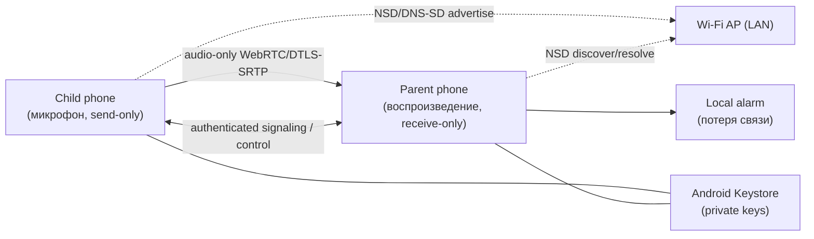
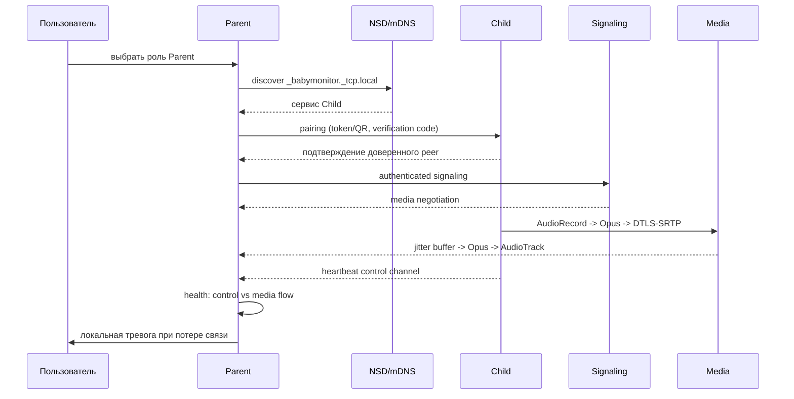

# Архитектура: Радионяня (Baby Monitor)

**Статус**: Bootstrap / not functional yet. Документ описывает целевую архитектуру и текущее
состояние каркаса. Мониторинг, discovery, pairing, media и foreground service ещё не реализованы.

## 1. Контекст системы

Два Android-телефона в одной локальной Wi-Fi сети. Интернет и облачный backend для основного
сценария не требуются. Внешние trust boundaries: Wi-Fi сеть (недоверенная), интерфейс
пользователя обоих устройств, Android OS/Keystore, будущий канал обновлений приложения.



## 2. Слои и направление зависимостей

```text
BabyMonitor.Domain             -> только BCL
BabyMonitor.Application        -> Domain
BabyMonitor.Infrastructure     -> Application, Domain
BabyMonitor.Platform.Android   -> Application, Infrastructure
BabyMonitor.App                -> Application, Infrastructure, Platform.Android
Tests                          -> тестируемые проекты
```

Зависимости проверяются architecture tests на каждом PR. Android/WebRTC/NSD-типы не пересекают
границы Application/Domain contracts.

| Проект | Ответственность | Что есть сейчас (bootstrap) |
|---|---|---|
| BabyMonitor.Domain | модель, инварианты, состояния, типизированные причины | DeviceRole (Unknown/Child/Parent, default не включает микрофон) и Complement-инвариант |
| BabyMonitor.Application | use cases и порты, orchestration, Result | Result/Error контракты |
| BabyMonitor.Infrastructure | WebRTC, signaling, discovery, pairing, persistence, logging adapters | только маркер сборки |
| BabyMonitor.Platform.Android | AudioRecord/AudioTrack, services, permissions, notifications, connectivity, Keystore | только маркер сборки |
| BabyMonitor.App | MAUI или .NET for Android UI, MVVM, composition root | Android Activity-оболочка со статусом bootstrap |
| Tests | unit/contract/architecture/device | domain/application/architecture tests + contract suite IRealtimeTransport (22 теста на fake) |

## 3. Целевой runtime (planned)



Состояние сессии моделируется одним конечным автоматом MonitoringSession, а не набором bool.
«WebRTC connected» не считается доказательством того, что пользователь слышит звук: control
channel и media flow проверяются независимо.

## 4. Trust boundaries и безопасность

- Wi-Fi LAN недоверенная: pairing, аутентификация signaling и DTLS-SRTP обязательны.
- Private keys — только Android Keystore; собственные крипто-схемы запрещены.
- Cleartext HTTP/WebSocket для pairing/signaling запрещён; отключение TLS validation запрещено.
- mDNS TXT не содержит имени ребёнка, владельца, постоянного device ID, ключей и pairing secrets.
- Tokens одноразовые, короткоживущие, с защитой от replay; потерянное устройство удаляется из
  trusted store.
- Логи и телеметрия не содержат аудио, секретов, fingerprint целиком, private IP и имён детей.
- Child: send-only audio; Parent: receive-only audio, без RECORD_AUDIO.

## 5. Фоновая работа и permissions

- Мониторинг — только через foreground service с постоянным notification и действием Stop.
- Child service: тип microphone; Parent service: тип mediaPlayback.
- Service запускается явным действием пользователя при видимой Activity; после reboot микрофон
  автоматически не стартует.
- Manifest permissions минимальны и зависят от роли/runtime path; Parent не получает microphone
  permission «на всякий случай».
- Activity может быть уничтожена без остановки активного service; service не хранит View/Activity.

## 6. Ошибки, надёжность, диагностика

- Ожидаемые исходы use case — типизированный Result; нарушения инвариантов — DomainException.
- Platform exceptions перехватываются на границе адаптера и преобразуются в application error.
- Reconnect: единая политика с exponential backoff + jitter и верхним пределом; все retry loops
  принимают CancellationToken и имеют владельца.
- Correlation identifiers: SessionId, ConnectionAttemptId, обезличенный PeerId.
- Метрики: underruns, packets sent/received/lost, RTT/jitter, media silence, buffer depth,
  encode/decode duration, reconnect count/duration, service lifetime, battery drain в soak.

## 7. CI/CD и версионирование

- CI: pull_request, push main, workflow_dispatch → restore, build (warnings as errors), tests,
  architecture tests, debug APK artifact (14 дней), без signing secrets.
- Release: push tag vMAJOR.MINOR.PATCH → проверка SemVer и CHANGELOG → повторные restore/build/test
  → подпись только при наличии secrets в Environment release → SHA-256 → GitHub Release.
- Workflow не создаёт/не двигает теги. Первый release не выполнялся.
- versionCode = MAJOR*10000+MINOR*100+PATCH (ADR-0009).

## 8. Текущее состояние (честно)

- Реализовано: solution и references, domain/application контракты-минимумы, порт
  `IRealtimeTransport` + contract suite (22 теста на fake), Android activity-shell без permissions,
  docs/ADR/spec, тесты каркаса, CI/release-конфигурация.
- Не реализовано: WebRTC/Opus, AudioRecord/AudioTrack, NSD, pairing, foreground service,
  уведомления, ViewModels, reconnect/alarm, Keystore-идентичности.
- Решения, требующие spike, остаются Proposed: media library (ADR-0005), UI framework (ADR-0006),
  local TLS/signaling/pairing (ADR-0007), update strategy (ADR-0008).

## 9. Ссылки

- [AGENTS.md](../../AGENTS.md)
- [Конституция](../../.specify/memory/constitution.md)
- [ADR index](adr/)
- [Vision](../product/vision.md)
- [Roadmap](../product/roadmap.md)
